# CC:Tweaked-Draconic Manager

A ComputerCraft: Tweaked program that runs **Draconic Evolution** reactors
and, when installed, **Extreme Reactors** / **Bigger Reactors** reactors and
turbines and **Mekanism** fission, fusion, turbines and boilers, from one
computer with a touchscreen dashboard.

Each mod is optional: with only Draconic Evolution you get the Draconic
features, with only Extreme/Bigger Reactors you get those, and with both
everything shows up side by side.

For Draconic reactors it charges and starts them, holds the containment
field and core temperature at their targets, and trips to a controlled
shutdown on unsafe conditions.

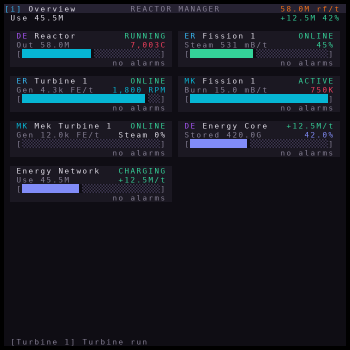

**New here? Read the [illustrated walkthrough](docs/GUIDE.md)**: every
screen, button and alarm, step by step.

> [!WARNING]
> **Not tested in Minecraft yet.** What has been tested:
> - automated tests against reactor simulators;
> - a full end-to-end run in the [CraftOS-PC](https://www.craftos-pc.cc)
>   emulator (ComputerCraft 1.116.1 runtime, real monitors and touch), with
>   the mods replaced by those simulators ([results](docs/ui/craftos/results.txt)).
>
> Nothing has run in Minecraft with the real Draconic Evolution, Extreme /
> Bigger Reactors or Mekanism blocks. In game, rendering may vary and parts
> **may not work at all**, and the mods' real behaviour can differ from the
> simulators. Try it in a creative or test world first, keep backups, and
> set `config.ui.theme = "classic"` if the colours look wrong. Bug reports
> are welcome.

## Features

- **Field regulation**: input gate set to `fieldDrainRate / (1 - targetField)`, which holds the field at 50% by default.
- **Temperature regulation**: a cascade controller holds the core at `targetTemperature` (7000 °C by default). The outer loop picks an energy-saturation setpoint and the inner loop holds it. This matters on DE 1.16+, where below about 10% saturation the core gains hundreds of degrees per tick.
- **Manual output mode** with ±1k / 10k / 100k buttons. Increases ramp in slowly, and an interlock switches back to AUTO when heat climbs.
- **Trips**: when a limit is crossed the reactor gets a controlled stop. The containment field stays fed until the reactor is cold. The limits are:
  - temperature above `maxTemperature` (8000 °C)
  - field below `minField` (20%)
  - remaining fuel below `minFuel` (10%)
- **Auto-restart**: after a temperature or field trip the reactor resumes as soon as it has cooled below `safeTemperature`, straight from its shutdown (Draconic Evolution allows re-activation above 2000 °C), so there is no full cooldown and recharge. This is capped at 3 restarts per hour, after which a person has to press START. A low-fuel trip never restarts on its own.
- **Wiring check**: if charging makes no progress for 30 seconds, an alarm says the input gate isn't reaching the energy injector (wrong gate, a fluid gate, or no power behind it).
- **Remembers manual modes**: manual output (Draconic) and manual rods (Extreme/Bigger Reactors) survive reboots.
- **Hot-plug**: machines connected while the program runs are picked up within a few seconds, with no restart. A second Draconic reactor still needs the setup wizard (restart) or `config.lua`, because its gates have to be assigned.
- **Fail-safe exit**: if the program stops (Ctrl+T, crash, reactor link lost), the output gate goes to 0 and the input gate to twice the last field demand. With output at 0, saturation climbs and field drain collapses, so that margin is wide.
- **Plug-and-play detection**: peripherals are found by the methods they expose, not by their names. On DE 1.16 to 1.20 flux gates report the type `flow_gate`, not `flux_gate`. This breaks drmon and was one cause of [issue 5](https://github.com/owzo/CC-Tweaked-Draconic-Manager/issues/5). Detection works with any modem name. If two gates are found you are asked once which one is the input, and the answer is saved.
- **Dashboard** (styled after drmon, themed from a Google Stitch design): shows status, generation, temperature, field, saturation, fuel, gate rates, an optional energy core readout and alarms. It redraws through a buffer, so there is no flicker. It works on any number of monitors and falls back to the computer screen when none are attached.
- **Energy storage**: Draconic energy cores, Mekanism induction matrices and energy cubes, Flux Networks, Powah, EnderIO, Thermal and any Forge-energy block, with input/output/net flow, time to full/empty and an **Energy Network** view (generation, storage flow, consumption). See [Energy storage](#energy-storage).
- **Logging**: events go to `logs/draconic.log` and a stats CSV to `logs/reactor_stats.csv`. Both rotate in size so the disk can never fill up. Optionally every line is also sent to a small collector on a real computer (see [Logs on a real computer](#logs-on-a-real-computer)).

## Requirements

- Minecraft with **Draconic Evolution** and **CC:Tweaked**
- A fully built reactor (core, 4 stabilizers, 1+ injector) fuelled with **awakened** draconium (1–8 blocks)
- Two **flux gates**:
  - **input gate**: energy source → gate → reactor **energy injector**
  - **output gate**: reactor **stabilizer** → gate → your storage (energy core)
- An **Advanced Computer**
- Optional: advanced monitors (3x3 recommended) and energy storage (energy core pylon, induction matrix, ...)

### Wiring (read this first)

```text
  [Computer]--wired modem
                  |  networking cable
                  +--wired modem--[Reactor Stabilizer]
                  +--wired modem--[Input Flux Gate]   (feeds Energy Injector)
                  +--wired modem--[Output Flux Gate]  (fed by a Stabilizer)
                  +--wired modem--[Monitor]           (optional)
                  +--wired modem--[Energy Pylon]      (optional)
```

- Use **wired** modems and networking cable. *Wireless and ender modems
  cannot attach peripherals.* Earlier versions of this README said to use
  wireless modems, and that is why "input flux gate not found" happened ([issue 5](https://github.com/owzo/CC-Tweaked-Draconic-Manager/issues/5)).
- **Right-click every wired modem** after placing it. The ring turns red and
  chat prints `Peripheral "flow_gate_0" connected to network`. A modem that
  hasn't been right-clicked is invisible to the computer.
- Instead of a modem you can place a peripheral directly against the computer.
- Run `peripherals` in the computer shell to see what it can reach.

## Installation

```shell
wget https://raw.githubusercontent.com/owzo/CC-Tweaked-Draconic-Manager/main/install.lua install.lua
install
```

The installer downloads every file before writing any of them, so a failed
download changes nothing. It keeps an existing `config.lua` and creates
`startup.lua`, so the manager restarts after reboots and chunk reloads.
Running `install` again updates the program.

### Offline (HTTP API disabled)

1. Put all `.lua` files from this repository on a floppy disk. In single
   player you can copy them into
   `saves/<world>/computercraft/disk/<disk id>/`.
2. Insert the disk into a disk drive next to the computer.
3. Run `disk/offline_install`.
4. Remove the disk, then run `main_control` (or reboot).

## First run

1. Run `main_control`.
2. If it lists two flux gates, enter the number of the gate that feeds the
   **energy injector**. This is saved. To change it later:
   `set draconic.inputGate flow_gate_1` and `set draconic.outputGate flow_gate_0`.
3. Press **START** on the monitor. The manager charges the reactor, activates
   it when warm-up is complete, then regulates it.

A reactor that is already running when the program starts keeps running. A
cold reactor is only charged after START, unless `autoStartOnBoot = true`.

## Multiple reactors

One computer can run any number of Draconic reactors. Each reactor needs its
own pair of flux gates on the same wired network, and runs in its own control
loop, so a slow or broken reactor never delays the others.

- **Setup wizard:** with several reactors and nothing in `config.lua`, the
  first run asks, for each reactor peripheral, which gate feeds its injector
  and which takes its output, and lets you name it. If you put modems on two
  blocks of the *same* reactor, it appears twice: leave the input gate blank
  to skip the duplicate. The answers are saved; run `set draconic.units nil`
  to set up again.
- **Or list them in `config.lua`.** Per-reactor `settings` override the
  shared `config.reactor` values:

  ```lua
  config.peripherals.reactors = {
      {name = "Alpha", reactor = "draconic_reactor_0",
       inputGate = "flow_gate_0", outputGate = "flow_gate_1"},
      {name = "Beta",  reactor = "draconic_reactor_1",
       inputGate = "flow_gate_2", outputGate = "flow_gate_3",
       settings = {targetTemperature = 6500}},
  }
  ```

- **Monitors:** see [Menus and monitors](#menus-and-monitors).
- **Logs:** log lines are tagged `[Alpha]`, and every reactor gets its own
  stats file (`logs/draconic_alpha.csv`).

## Extreme Reactors / Bigger Reactors

Put a **Computer Port** in each reactor and turbine and connect it with a
wired modem (right-clicked) or place it against the computer. Both mods are
detected automatically, as is the difference between passive (FE) and
active (steam) cooling. Settings live in `config.extreme`.

| Unit | What the program does |
| --- | --- |
| Passive reactor | Moves the control rods so the reactor's own FE battery stays between `bufferLow` and `bufferHigh` (30–70%). It estimates real demand from production and the change in stored energy, so it tracks load changes. Rods go fully in as soon as the battery is full, because both mods throw away energy (and fuel) when it is. |
| Active (steam) reactor | Matches steam production to what the turbines are set to draw, and uses its steam tank level only as a trim. A steam tank holds only seconds of mismatch, too little to steer by on its own. |
| Turbine | Spins up with the coils off (engaged coils brake the rotor; Bigger Reactors turbines start engaged), then a PI loop on steam flow holds `targetRPM` (1800, the efficiency peak in both mods). When the turbine's own buffer is full, the coils switch off and the rotor is kept at speed; they switch back on below `coilsOnBelow`. Steam is cut above `maxRPM`. |

By default all steam-cooled reactors and turbines on the network are treated
as one steam system (the usual build: reactors feed a shared pipe network).
If you run separate steam systems, give each unit a `steamGroup`; only
units in the same group share steam demand:

```lua
config.extreme.units = {
    {peripheral = "BigReactors-Reactor_0", steamGroup = "A"},
    {peripheral = "BigReactors-Turbine_0", steamGroup = "A"},
    {peripheral = "BigReactors-Reactor_1", steamGroup = "B"},
    {peripheral = "BigReactors-Turbine_1", steamGroup = "B"},
}
```

**Tuning:** every control loop has a speed multiplier you can change live on
the unit's `S` page: `Output Gain` (Draconic), `Rod Gain` (fission) and
`Flow Gain` (turbines). Lower it if rods, output or flow keep hunting back
and forth; raise it if the buffer, temperature or RPM drifts and recovers
slowly. Changes are saved, and `RESET` returns to `config.lua`.

**Neither mod can melt down or explode**, and turbines take no damage from
overspeed. The worst outcome of bad control is wasted fuel or steam, so
these controllers aim for efficiency rather than safety margins.

**Waste and fuel:** waste shares the fuel tank, so once it passes
`wasteEjectAt` (20% of the tank) the program ejects it. That needs a reactor
access port set to output. If waste keeps piling up past `wasteAlarmAt`
anyway, an alarm says to check the access port. Fission pages show fuel and
waste side by side, and low fuel raises an alarm.

Each page has `START` / `STOP` (activate or deactivate). Reactor pages also
have `-10 -1 AU +1 +10`, where `AU`/`MA` toggles automatic rod control and
the other buttons set the rods by hand. Name units or override settings per
unit in `config.extreme.units`.

| Mod difference | Handled by |
| --- | --- |
| Extreme Reactors setters apply a tick later and never raise errors | Values are validated before sending, and only changes are written |
| Bigger Reactors reports temperatures in Kelvin | Converted to °C |
| Bigger Reactors has no battery when actively cooled, and object accessors (`battery()`, `rotor()`) | Hidden behind one adapter (`er_utils.lua`) |
| Bigger Reactors turbine vents can't be set from CC | Not touched by the program in either mod |

## Energy storage

Energy stores on the network are found automatically and shown read-only
next to the reactors, each with its own page (stored, capacity, input,
output, net flow, time to full or empty, charge bar) and graphs. Storage is
optional and works with any mix of reactor mods. Everything is shown in FE
(= RF) per tick.

| Mod / block | How it is detected | Flow figures |
| --- | --- | --- |
| Draconic Evolution energy core | Energy **pylon** (`draconic_rf_storage`) | Input / output per tick from the pylon (DE 1.18+), else its net transfer |
| Mekanism induction matrix | **Induction Port** (`inductionPort`) | `getLastInput` / `getLastOutput` |
| Mekanism energy cube | `basicEnergyCube` … `creativeEnergyCube` | Measured from the stored energy |
| Flux Networks | Flux **Controller** with the [UnlimitedPeripheralWorks](https://github.com/SirEdvin/UnlimitedPeripheralWorks) addon (`flux_controller`): network energy and `getStatistic()` input/output. Flux Networks itself has no CC support on 1.20.1 | Network input / output |
| Powah energy / ender cells | Advanced Peripherals (`energyCell`, `enderCell`), or CC's generic peripheral without it | Measured |
| EnderIO capacitor banks, Thermal energy cells, anything else with Forge energy | CC:Tweaked's generic **`energy_storage`** peripheral (`getEnergy` / `getEnergyCapacity`) on a wired modem | Measured |
| Advanced Peripherals **Energy Detector** (`energyDetector`) | Shown as an **Energy Meter**: the FE/t passing through it. Never changes its limit | Measured by the block |

Notes from the mods' source:

- **Mekanism reports Joules.** They are converted to FE with Mekanism's own
  `mekanismEnergyHelper.joulesToFE` (so a server's custom conversion rate is
  honoured), or 2.5 J = 1 FE when that API is missing.
- CC's generic `energy_storage` returns 32-bit numbers, so a block holding
  more than 2.1G FE reads as 2.1G (its page then says `OVER 2.1G`). Use the
  mod's own peripheral where one exists (pylon, induction port).
- CC only offers the generic peripheral for blocks **without** a peripheral
  of their own, and per side: a side configured to "none" may show nothing.
- Draconic tier-8 cores beyond the 64-bit range are read through the pylon's
  `...InNotation` methods.

**Nothing is counted twice:**

- Peripherals other drivers control (Draconic reactors and flux gates,
  Extreme/Bigger Reactors computer ports) are skipped.
- Generic energy blocks of reactor mods (reactor/turbine power taps) and
  Flux Networks plugs/points (only a small transfer buffer) are skipped.
- Several ports of one induction matrix (same multiblock bounds), and several
  blocks of one EnderIO capacitor bank or Powah ender network (same type and
  identical readings at discovery), count once. Two separate stores of the
  same type that read exactly the same at that moment would also be merged;
  name them in `exclude`/`include` if that ever happens.

### Flow math

For each store the **net flow** (+ charging, − discharging) is
`input − output` when the mod reports both, the mod's own net figure when
it reports one, otherwise the change in stored energy over game time
(`Δstored / Δticks`). Rates are smoothed with a 5-second exponential
average. **Time to full** is `(capacity − stored) / net`, **time to empty**
`stored / −net`.

The **Energy Network** (its own card, page and graphs, plus a line under the
Overview total) adds everything up:

```text
generation   = sum of producing units' output   (Draconic output gate, ER/BR FE)
storage net  = sum of every store's net flow
consumption  = generation − storage net          (includes the Draconic injector draw)
```

Example: a Draconic reactor outputs 60M RF/t into an energy core and the core
gains 35M RF/t, so the base (injector included) uses 25M RF/t. Generation
the program does not control (solar, other generators) is not counted, so
consumption is a lower bound in that case. Stats go to
`logs/storage_<name>.csv` and `logs/energy_network.csv`.

### Configuration

```lua
config.storage = {
    enabled = true,
    include = {},     -- non-empty: use ONLY these peripherals (also forces skipped ones)
    exclude = {},     -- never use these
    names   = {inductionPort_0 = "Main Matrix"},
    pollInterval = 1  -- seconds; every reading costs a server tick
}
```

Entries are peripheral names as `peripherals` prints them; `*` matches
anything (`"enderio:*"`). `config.peripherals.energyCore` still works: that
peripheral becomes the **primary** store, the one shown on Draconic reactor
pages (otherwise the first Draconic pylon, then the first other store).

## Mekanism

Fission reactors, fusion reactors, industrial turbines and thermoelectric
boilers are found automatically through their ports/valves. Several ports on
one structure count as one unit.

**A Mekanism fission reactor can melt down.** Damage builds above 1200 K, and
at 100% damage an explosion is likely within about a minute (meltdowns are
on by default). The program protects it the way the widely used cc-mek-scada
does, and SCRAMs (instant shutdown) on any of these:

| Trip | Default (`config.mekanism`) |
| --- | --- |
| Temperature | ≥ 1000 K (`maxTemperature`; can't be set above 1150) |
| Damage | any (`maxDamage = 0`) |
| Coolant | < 20% |
| Heated coolant / steam | > 95% (turbines not keeping up) |
| Waste | > 90% |

- **No automatic restart after a trip:** a person presses START.
- **The burn rate ramps up gradually** to the target you set (`-10 -1 +1 +10`
  on the page). It is cut back automatically while the temperature is within
  100 K of the trip or coolant runs low, so most excursions are handled
  before a SCRAM is needed.
- **When the program stops** (Ctrl+T, crash, update), running fission
  reactors are SCRAMmed (`scramOnExit`), because an unsupervised reactor is
  the riskier state. Make sure the computer is chunk-loaded.
- **Turbines and boilers** are monitored, with alarms for steam backing up
  or low water.
- **Fusion reactors** can't explode. They're monitored, and the injection
  rate is adjustable with `-2 / +2` (it must be even).
- **Every Mekanism call costs a server tick**, so all readings are taken in
  parallel each cycle. Energy is converted from Mekanism's Joules to FE
  using the server's own conversion rate.

## Alarms

Every unit alarm (trip, low fuel, waste, link lost, charging stalled,
overspeed, no steam...) can reach players away from the monitor:

| Output | Needs | Behaviour |
| --- | --- | --- |
| Bell | Any speaker on the network | Rings on a new alarm, then every `repeatSeconds` while it lasts |
| Chat | Advanced Peripherals **Chat Box** | One message per new alarm, and one when everything has cleared |
| Redstone | `redstoneSide` (computer side) or an AP **Redstone Integrator** | On while any alarm is active: lamps, sirens, or wire it into a hardware shutdown |

**Tap the red alarm bar** at the bottom of any page (or `SILENCE` on the
System page) to stop the bell until a new alarm appears. Alarms are also
written to the log (`ALARM <unit>: <text>`). Settings are in `config.alarms`.

## System page, updates and totals

Tap `[i] Overview` (the top row of the Overview) for the System page:

- **Version** and **update check**. `CHECK` asks GitHub for the latest
  version; `UPDATE`, then `CONFIRM` within 10 seconds, puts every reactor in
  its fail-safe state, runs the official installer (which keeps your
  `config.lua`) and reboots into the new version. Source: `config.update.repoBase`.
- **Energy totals**: energy produced in the last 24 hours, lifetime total,
  and a per-hour bar chart, kept across reboots in `data/totals.db`. Each
  unit's Graphs page also starts with its own energy-per-hour chart.
- **Alarms**: how many are active, one row per active alarm (unit and
  message) when the monitor has room, and `SILENCE`.
- **Log shipping**: `OK` / `FAILING` and the number of queued lines when
  [remote logging](#option-2-send-the-logs-to-a-collector-any-pc-or-server)
  is enabled.

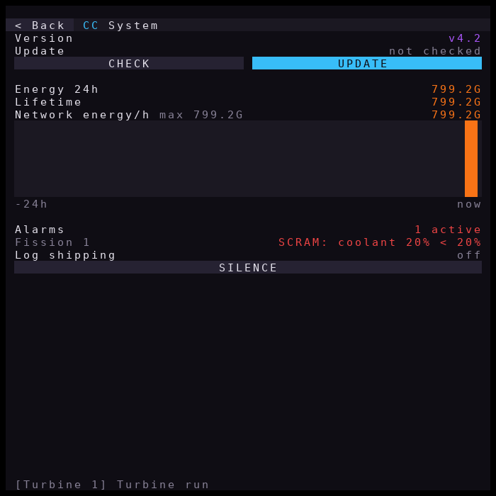

## Menus and monitors

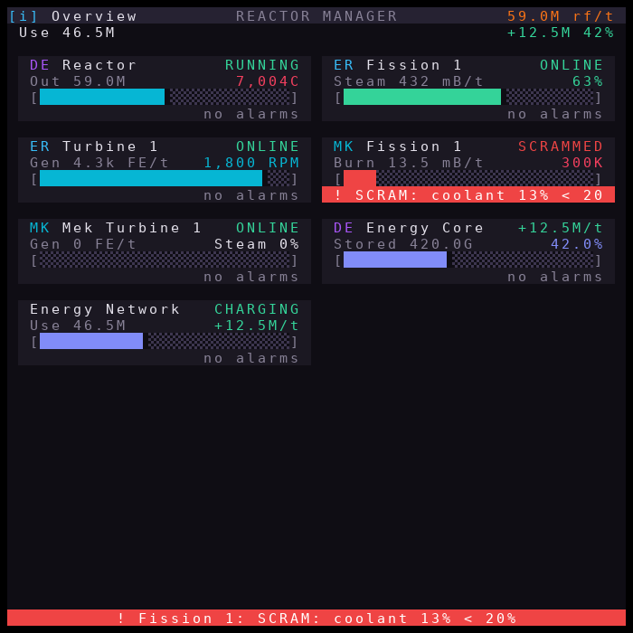

> [!NOTE]
> Screenshots are simulated (see the warning at the top). The
> [walkthrough](docs/GUIDE.md) shows every page with what each part does.

With more than one unit (reactor, turbine or energy store), every monitor
opens on the **Overview**: total generation in the top bar (tap it for the
System page), then one card per unit with its mod tag (`DE`, `ER`, `BR`,
`MK`...), name, status, key reading, a bar and its alarm strip. Monitors 55
columns or wider (a 3x3 at text scale 0.5 is 57x38) show two columns of
cards. Tap a card to open that unit's page. If there are more cards than
fit, `<` / `>` in the footer pages through them; the rest of the footer
shows the first active alarm (tap it to silence the alarm sound).

| Unit page (57x38) | Graphs (57x38) | Compact 3x3 at scale 1 (29x19) |
| --- | --- | --- |
| 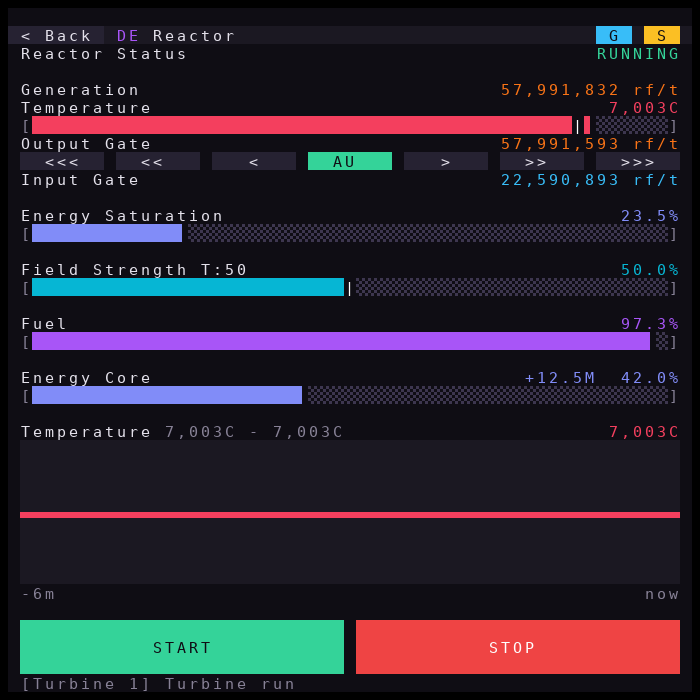 | 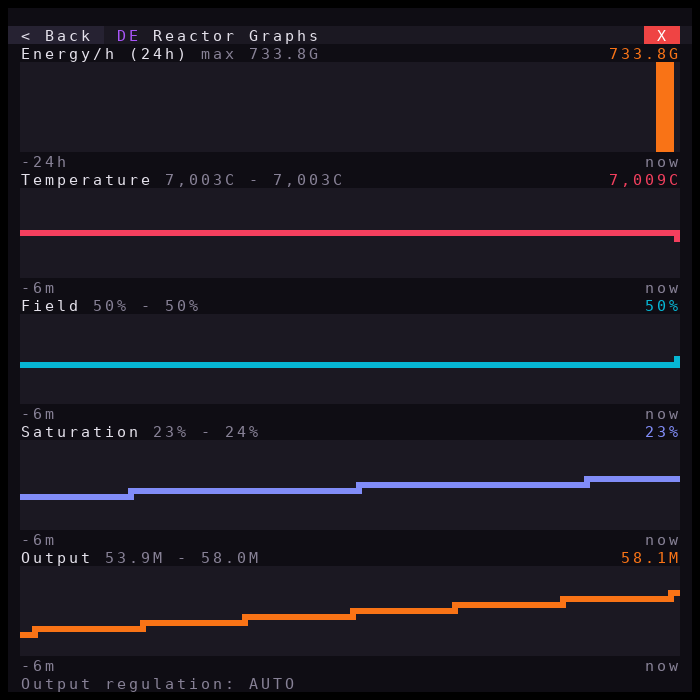 | 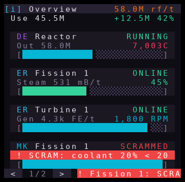 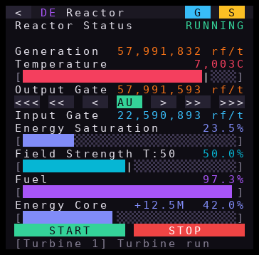 |

Every unit page has a navigation row at the top:

| Button | Opens |
| --- | --- |
| `<` / `< Back` | Back to the Overview |
| `G` | **Graphs**: history charts. Draconic: temperature, field, saturation, output. Fission: buffer, generation, rods. Turbine: RPM, generation, steam flow. Storage: charge, net flow, input, output. Energy Network: generation, consumption, storage net, charge. One sample every `ui.graphInterval` seconds. The first chart is energy per hour over the last day. |
| `S` | **Settings**: the unit's tunable values, each with `-` / `+` |
| `X` | Back to the unit page (from Graphs or Settings) |

Charts use ComputerCraft's 2x3-dot characters, so a 57-wide monitor plots
110 points per chart. Line charts zoom to the range of their samples (the
range is printed beside the title); bar charts start at zero. On tall
monitors the unit page fills its spare rows with live trend charts.

**Settings apply immediately and are saved** (`data/manager.db`), so they
survive reboots. A value changed from its `config.lua` default is shown in
purple, with the default beside it on wide monitors. Linked limits are enforced: a target can never pass its trip
limit, and Draconic field and temperature targets stay inside their trips.
`RESET` returns that unit to its `config.lua` values.

| Unit | Settings |
| --- | --- |
| Draconic | Target / trip temperature, target / trip field, restart temperature, auto-restart |
| Fission | Buffer band low / high |
| Turbine | Target RPM, steam cut-off RPM, coils-off / coils-on buffer levels |

**Dedicated monitors:** `PIN HERE` on a unit's Settings page keeps that
monitor on that unit, remembered across reboots; press `UNPIN` to free it.
The same can be set in `config.lua`, by unit name:

```lua
config.ui.monitorUnits = {monitor_1 = "Alpha", monitor_2 = "Turbine 1"}
```

Any mix works: one monitor on the Overview, others pinned to single reactors.
Each monitor navigates on its own.

## Controls

| Button | Action |
| --- | --- |
| `<<<` `<<` `<` / `>` `>>` `>>>` (under Output Gate) | Output −/+ 100k, 10k, 1k RF/t (switches to manual) |
| `AU` / `MA` (middle of that row) | Toggle automatic temperature regulation (green = auto, yellow = manual) |
| `START` | Charge + activate; clears a latched trip |
| `STOP` | Controlled shutdown (field stays fed until cold) |

The layout follows [drmon](https://github.com/acidjazz/drmon)'s look:
- label on the left, value on the right
- full RF/t figures with separators
- colour-coded bars with half-cell precision and target markers (`|`)
- blank rows between sections
- the last action, or an active alarm, on the bottom line

The layout fits itself to the monitor: on a 3x3 it drops spacer rows first,
and larger monitors get more breathing room (taller START / STOP buttons,
trend charts).

### Theme

The default `obsidian` theme was designed in Google Stitch
([brief](docs/ui/stitch_prompt.md)): a dark violet control-room look. A
monitor has 16 colour slots and CC:Tweaked lets a program set each one to
any RGB value, so the manager recolours them at start-up and puts the stock
palette back on exit (the last screen then gets a red "MANAGER STOPPED"
banner, so a frozen dashboard is never mistaken for live data).

| Role | Colour | Used for |
| --- | --- | --- |
| background / panel / panel-alt / border | `#0f0d14` `#1b1822` `#262232` `#3d364f` | screen, cards, buttons, bar tracks |
| text / text-dim / white | `#e4e1eb` `#878196` `#ffffff` | values, labels, alarm text |
| ok / warn / danger | `#34d399` `#fbbf24` `#ef4444` | status, START / STOP, alarms |
| info / accent | `#38bdf8` `#a855f7` | rates, Draconic, changed settings |
| energy / heat / coolant / field | `#f97316` `#f43f5e` `#06b6d4` `#818cf8` | generation, temperatures, coolant / RPM, field / storage |

Set `config.ui.theme = "classic"` to keep the stock ComputerCraft colours
(for example when other programs share the monitors).

In manual mode, output increases ramp in at 1% of generation per cycle. An
interlock switches back to AUTO when the temperature passes a quarter of the
way from the target to the trip limit, or when it rises faster than 100 °C/s
above the target.

## Configuration (`config.lua`)

| Key | Default | Meaning |
| --- | --- | --- |
| `peripherals.*` | `nil` | Force a peripheral name instead of auto-detecting |
| `reactor.targetTemperature` | 7000 | Regulated core temperature (°C) |
| `reactor.targetField` | 0.50 | Regulated field strength |
| `reactor.maxTemperature` | 8000 | Trip above this |
| `reactor.minField` | 0.20 | Trip below this |
| `reactor.minFuel` | 0.10 | Trip when remaining fuel is below this |
| `reactor.safeTemperature` | 3000 | Auto-restart only below this |
| `reactor.autoRestart` | true | Restart after temperature/field trips |
| `reactor.chargeInflow` | 2,000,000 | Input during warm-up (RF/t) |
| `reactor.maxInflow` | 100,000,000 | Input cap, also used for field emergencies |
| `reactor.maxOutflow` | 1,000,000,000 | Output cap (the regulator sets the real rate) |
| `reactor.outputAggressiveness` | 1.0 | Temperature loop gain multiplier |
| `reactor.controlInterval` | 0.05 | Seconds per control cycle (1 game tick) |
| `storage.*` | see [Energy storage](#energy-storage) | Storage include/exclude/names, poll interval |
| `ui.textScale` | auto | Monitor text scale |
| `logging.statsInterval` | 10 | Seconds between CSV rows |
| `logging.directory` | `logs` | Folder for every log and stats file |
| `logging.remote.enabled` | false | Send all logs to `tools/log_collector.py` (see [Logs on a real computer](#logs-on-a-real-computer)) |
| `logging.remote.url` / `token` | | Collector URL (`.../ingest`) and its `--token` |
| `logging.remote.batchSeconds` | 5 | Seconds between batches |
| `logging.remote.maxQueue` | 1000 | Lines kept while the collector is unreachable |
| `logging.remote.timeout` | 10 | Seconds per HTTP request |

The program checks the config at startup and refuses to run with
inconsistent limits (for example a target above the trip temperature).

## Compatibility (CC:Tweaked ↔ Draconic Evolution)

These were checked against both mods' source (DE `1.20` branch, CC:Tweaked
`mc-1.20.x`) and their issue trackers.

| Topic | What to know |
| --- | --- |
| **DE version (1.20.1)** | DE builds before August 2024 shipped broken CC integration ([DE PR 1817](https://github.com/brandon3055/Draconic-Evolution/pull/1817), [CC issue 1897](https://github.com/cc-tweaked/CC-Tweaked/issues/1897)). Gates, stabilizers and pylons only show up as CC's generic `energy_storage`, which can't control anything. **Use DE 3.1.2.604 or newer**; older modpacks such as early ATM9 are affected. The program detects this and tells you. |
| **Gate type name** | On DE 1.16–1.20 both flux and fluid gates report `flow_gate`. Detection is by method, so this works, but **a fluid gate looks identical to a flux gate**. If one shares the network, set `inputGate` / `outputGate` in `config.lua`. |
| **Which blocks are peripherals** | Reactor **stabilizers and injectors** (type `draconic_reactor`), **flow gates** and the **energy pylon** (`draconic_rf_storage`). The reactor core block and the energy core block are *not* peripherals. Modems attach on any face. |
| **Generic peripherals** | CC prefers a block's own peripheral over its generic ones, so DE methods are never mixed with `energy_storage`. Other mods' energy blocks can't be mistaken for the energy core. |
| **Call cost** | Every DE method runs on the server thread and takes about one tick. The program writes both gates in the same tick, skips writes that wouldn't change anything, and measures its real cycle time (`cycle_s` in the stats CSV). It warns above 0.25 s. |
| **Reactor not loaded** | `getReactorInfo()` returns nothing when the core's chunk is unloaded or the component is unbound. The program treats that as "blind": output 0 and input at twice the last field demand. |
| **Command results** | `chargeReactor` / `activateReactor` / `stopReactor` return `true` even when the reactor refuses. The program confirms every command by re-reading the status. |
| **Gate memory** | A gate's override and rate are saved with the world. If the computer stops, the gate keeps its last value, so chunk-load everything and keep `startup.lua`. |
| **Fail-safe** | DE 1.16+ only has `toggleFailSafe()` (not `setFailSafe`), and it doesn't protect against field loss. This program doesn't use it. |

## How the reactor works (DE 1.16 to 1.20, from the mod source)

- **It only explodes when the containment field reaches 0 while the core
  is above 2000 °C.** No temperature by itself triggers it. Very high
  temperature makes the field drain grow with the square of the overshoot
  above 8000 °C, roughly 3.5x at 9000 °C.
- **Generation** is `(1 − saturation) × base × (1 + 2 × conversion)`. Output
  rises steeply as fuel converts: an 8-block core at 8000 °C makes about 53M
  RF/t on fresh fuel and about 256M RF/t at 80% conversion (default
  `reactorOutputMultiplier`). DE 1.12 numbers are 1/100 of that.
- **Field input** gains `input × (1 − field%)`, and the injector wastes any
  excess. Holding 50% field costs 2x the drain, holding 25% costs 1.33x.
- **Stopping** still drains the field. The stabilizers stop outputting,
  saturation climbs, and the core cools only once saturation passes 99%.
  This program keeps the field fed until the core is `cooling`.
- **Calls cost a tick on 1.20**: every CC call into the reactor or a gate
  runs on the server thread. The gate adapter skips writes when the rate
  hasn't changed.

## Pushing it to the edge

Settings that fit the mechanics, from conservative to aggressive:

| Setting | Default (safe) | Edge |
| --- | --- | --- |
| `targetTemperature` | 7000 | 7900 |
| `maxTemperature` | 8000 | 8200 |
| `targetField` | 0.50 | 0.25 |
| `minField` | 0.20 | 0.12 |
| `minFuel` | 0.10 | 0.10 (never go past ~90% conversion) |

- **Most of the gain comes from temperature and fuel conversion, not the
  field.** Going from 50% to 25% field adds only a few percent of net output
  once conversion is high.
- **Don't run hotter than 8000 °C.** Going to 9000 °C adds about 10%
  generation but about 4x the field drain, a net loss with less margin.
- **A low field target costs reaction time.** By my calculation from the
  source formulas (not measured in game), a full 1.20 core at 8000 °C drains
  about 12% of its maximum field per tick when input stops. At 25%
  field you have about 2 ticks, at 50% about 4. That's why the program
  runs every tick and fails safe whenever it can't see the reactor.
- **Refuel at about 90% conversion.** Near 100% the core cannot cool down
  even at full saturation.
- **Laggy servers** shrink every margin. Keep the default settings there.

The edge settings are covered by a simulator test (`[DE 1.20] edge
tuning`). The simulator is not the game, so step toward them gradually and
watch `logs/reactor_stats.csv`.

## Operational notes

- **Your energy source has to be able to supply `maxInflow`.** If the core
  that feeds the injector runs dry, nothing can hold the field.
- **Keep the computer, the reactor and both gates chunk-loaded.** If the
  chunk unloads, the program stops while the gates hold their last setting.
  This is the most common cause of explosions.
- The input gate must feed an **energy injector**, and the output gate must
  take power from a **stabilizer**.
- A full energy core is safe. The reactor can't output, so saturation rises
  and the temperature falls.

## Logs on a real computer

Everything the program logs goes through one place (`stat_utils.lua`) into
`config.logging.directory` (`logs/` by default):

| File | Content |
| --- | --- |
| `draconic.log` | Every event (all levels), all units |
| `reactor_stats.csv` / `draconic_<name>.csv` | Draconic reactor stats, one row per `statsInterval` |
| `extreme_<name>.csv` | Extreme/Bigger Reactors reactor and turbine stats |
| `*.old` | The previous copy after a file passed `maxFileBytes` |

There are two ways to read them outside Minecraft.

### Option 1: read the files on the host disk

ComputerCraft keeps each computer's files as plain files in the world
save, under `computercraft/computer/<computer id>/`. Run `id` in the
computer's shell to get its id. The log folder is then:

| Where the world runs | Log folder |
| --- | --- |
| Singleplayer (or Open to LAN) | `.minecraft/saves/<world>/computercraft/computer/<id>/logs/` |
| Dedicated server | `<server folder>/<level-name>/computercraft/computer/<id>/logs/` (`<level-name>` is `world` unless `server.properties` changes it) |

You can open or tail these files while the game runs. A computer's disk
is limited (`computer_space_limit`, 1,000,000 bytes by default), which is
why the files rotate. This only works when you can reach the machine
Minecraft runs on.

### Option 2: send the logs to a collector (any PC or server)

The program can also POST every log line and every CSV row, including the
CSV headers, to `tools/log_collector.py`. The collector writes real files,
one folder per in-game computer:

```text
cc-logs/computer-7-Reactors/draconic.log
cc-logs/computer-7-Reactors/reactor_stats.csv
```

The folder is `computer-<id>`, plus `-<label>` when the computer has a
label (unsafe characters become `_`). If you change the label, a new
folder is started.

Shipping runs in its own coroutine. It never blocks reactor control. Lines
wait in a bounded queue (`maxQueue`, 1000 by default) while the collector
is down. When the queue is full the oldest lines are dropped. The drop
count is written to the local log and sent with the next batch. Failed
sends are retried with exponential backoff, up to one attempt a minute.
Messages from startup are buffered (last 200 lines) and sent once the
controller is running. Lines logged during shutdown are only kept locally.

**1. Run the collector.** You need Python 3.8 or newer and no extra packages:

```shell
python3 -c "import secrets; print(secrets.token_urlsafe(24))"   # make a token
python3 tools/log_collector.py --token <token> --bind 0.0.0.0 --port 8780 --root cc-logs
```

| Option | Default | Meaning |
| --- | --- | --- |
| `--token` | `$CC_LOG_TOKEN` | Shared secret (required) |
| `--bind` | `127.0.0.1` | Listen address. Use `0.0.0.0` (or the PC's LAN IP) when Minecraft runs on another machine |
| `--port` | 8780 | TCP port |
| `--root` | `./cc-logs` | Where the files go |
| `--max-bytes` | 10 MiB | Rotate a file to `.1` … `.N` beyond this size |
| `--backups` | 5 | Rotated copies kept per file |
| `--max-request` | 4 MiB | Largest accepted request body |

`GET /health` answers `{"ok": true}` so you can check that the collector is reachable.

**2. Allow the collector's address in CC:Tweaked.** By default CC:Tweaked
blocks every private address: localhost (127.0.0.0/8, ::1), LAN ranges
(10.0.0.0/8, 172.16.0.0/12, 192.168.0.0/16), link-local, 100.64.0.0/10
and others. The default rules are:

```toml
[[http.rules]]
    host = "$private"
    action = "deny"
[[http.rules]]
    host = "*"
    action = "allow"
    max_download = 16777216
    max_upload = 4194304
    max_websocket_message = 131072
    use_proxy = false
```

Rules are checked in order and the first matching rule that sets `action`
wins. Add an allow rule for your collector **above** the `$private` rule in
`computercraft-server.toml`:

```toml
[[http.rules]]
    host = "192.168.1.50"     # collector PC; "127.0.0.1" if it runs on the Minecraft machine
    port = 8780               # optional: only this port
    action = "allow"
[[http.rules]]
    host = "$private"
    action = "deny"
[[http.rules]]
    host = "*"
    action = "allow"
    max_download = 16777216
    max_upload = 4194304
    max_websocket_message = 131072
    use_proxy = false
```

`host` also accepts a CIDR range such as `"192.168.1.0/24"`. Keep
`[http] enabled = true`. If a rule is malformed, CC:Tweaked logs an error
and denies **all** HTTP, so check the game log after editing.

`computercraft-server.toml` is a per-world server config:

| Where the world runs | File |
| --- | --- |
| Singleplayer | `.minecraft/saves/<world>/serverconfig/computercraft-server.toml` (copy it to `.minecraft/defaultconfigs/` to apply it to new worlds) |
| Dedicated server | `<server folder>/<level-name>/serverconfig/computercraft-server.toml` |

Restart the world or server after editing it. A public `https://` URL,
for example the collector behind a reverse proxy with TLS, is allowed by
the default rules and needs no change.

**3. Turn it on in `config.lua`:**

```lua
config.logging = {
    ...
    remote = {
        enabled      = true,
        url          = "http://192.168.1.50:8780/ingest",
        token        = "<token>",
        batchSeconds = 5,       -- seconds between batches
        maxQueue     = 1000,    -- lines kept while the collector is down
        timeout      = 10       -- seconds per HTTP request
    }
}
```

Restart the program. At startup it checks that the `http` API exists, that
the URL is allowed (`http.checkURL`) and that a token is set. If any check
fails it logs a `WARN` explaining why, turns remote logging off, and keeps
logging locally. The reactors are not affected either way.

**Security notes**

- The token is the only thing stopping anyone who can reach the port from
  writing files into `--root`. Use a long random token. Anyone who can read
  `config.lua` on the computer can see it.
- Plain `http://` sends the token and the logs unencrypted. That is fine on
  your own LAN or on the same machine. **Don't expose the collector to the
  internet directly.** Put it behind a reverse proxy with TLS
  (Caddy, nginx) and use the `https://` URL, or use a VPN.
- Bind to `127.0.0.1` when Minecraft and the collector share a machine.
  Otherwise bind to the LAN address and firewall the port.
- The collector only writes `*.log`, `*.csv` and `*.txt` files with simple
  names inside its own folder. It rejects path traversal, absolute paths
  and symlinked folders.

## Troubleshooting

| Error | Cause and fix |
| --- | --- |
| `Failed to load API reac_utils` / `attempt to call global 'require' (a nil value)` | Old version that used `os.loadAPI`, where APIs run without `require` ([issue 3](https://github.com/owzo/CC-Tweaked-Draconic-Manager/issues/3)). Run the installer again. Current modules never call `require`, and `main_control` falls back to loading files directly if it is started without the shell. |
| `No reactor found` / `Need two flux gates` | Check the wiring (wired modems, right-clicked). The message lists every peripheral the computer can see; compare it with `peripherals`. |
| Only `energy_storage` peripherals listed | Draconic Evolution build too old for CC. Update to 3.1.2.604+ (see Compatibility). |
| `Control loop runs every …s` warning | Server lag. Keep conservative limits. |
| `Remote log: http://… is blocked: Domain not permitted` | CC:Tweaked denies private/LAN/localhost addresses by default. Add an allow rule for the collector above the `$private` rule in `computercraft-server.toml`, then restart the world or server (see [Logs on a real computer](#logs-on-a-real-computer)). |
| `Remote log: the http API is not available` | `[http] enabled = false` in `computercraft-server.toml`. Turn it on, or read the files on the host disk instead. |
| `Remote log: collector unreachable: Connection refused` | The collector is not running, or it listens on `127.0.0.1` while Minecraft runs on another machine (use `--bind 0.0.0.0`), or a firewall blocks the port. Lines wait in the queue and are retried. |
| `Remote log: collector unreachable: … (HTTP 401)` | `config.logging.remote.token` does not match the collector's `--token`. |
| `Remote log: N entries were dropped` | The collector was down long enough to fill `maxQueue`. Raise it, or fix the collector sooner. The full log is still on the computer. |
| Collector folder is missing a computer | The folder is `computer-<id>-<label>`. Run `id` on the computer, and check the collector output: it logs every batch and every rejected request. |
| `CHARGING STALLED - CHECK INPUT GATE` | The input gate isn't feeding the energy injector: the wrong gate was picked (run `set draconic.inputGate <name>`), it's a fluid gate, or the energy source is empty. |

## Development

### Trying it on your PC (CraftOS-PC)

[CraftOS-PC](https://www.craftos-pc.cc), by JackMacWindows
([MCJack123/craftos2](https://github.com/MCJack123/craftos2), MIT),
emulates a ComputerCraft computer with monitors in their own windows (click
one to touch it). Install it from its website; it is not bundled here. It cannot load
the reactor mods, so `tools/craftos/sim_world.lua` adds the test simulators
as peripherals (a Draconic reactor and energy core, a Bigger Reactors
reactor with a turbine, and a Mekanism fission reactor with a turbine),
attaches two monitors on the `top` and `left` sides, and runs
`main_control.lua` unchanged:

```text
craftos --mount-ro /repo=<path to this repository>
> /repo/tools/craftos/sim_world          (or: sim_world draconic | extreme | mekanism)
```

Press `c` on the computer screen to cut / restore the Mekanism coolant
(SCRAM test); hold Ctrl+T to stop. Monitor windows can be resized; the
dashboard re-fits itself.

`tools/craftos/run_scenario.sh <craftos build dir> <rom dir>` runs a
scripted end-to-end session on a virtual display (Xvfb, xdotool,
ImageMagick). It taps through every page, starts the reactors, uses manual
modes, changes and resets a setting, cuts the Mekanism coolant, silences
the alarm and stops the program with Ctrl+T. It checks every step and
saves screenshots of the real CraftOS-PC monitors
([latest results](docs/ui/craftos/results.txt)):

| Overview (56x38) | Draconic page | Alarm | 29x19 |
| --- | --- | --- | --- |
| 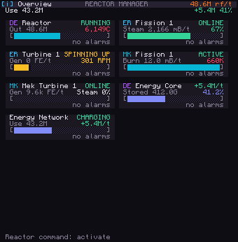 | 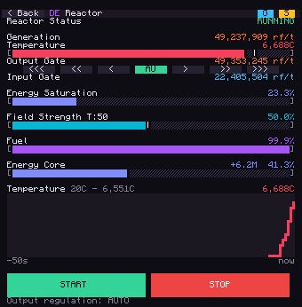 | 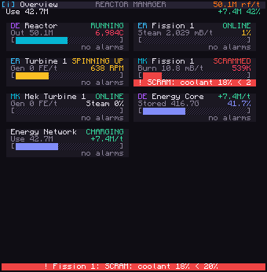 | 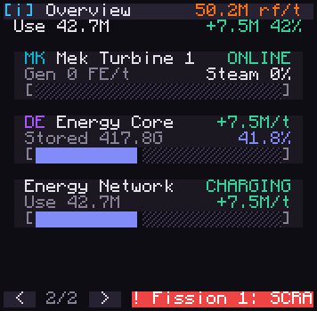 |

This run found a real bug that the unit tests had missed: in CC:Tweaked,
changing a monitor's text scale fires `monitor_resize`. The display setup
answered every resize by setting up again, so any monitor at scale 0.5 got
stuck in a resize loop and lost taps. It is now fixed, with a regression
test.

### Screenshots

Screenshots in `docs/ui/` are generated: `python3 tools/screenshots/render.py`
(needs Pillow and lupa) runs `tools/screenshots/scenes.lua`, which drives
`main_control.lua` against the simulators and dumps the monitors.

```text
main_control.lua       scheduler: loads drivers, one coroutine per unit, UI, input, fail-safe exit
persist.lua            saved in-game settings and monitor pins (data/manager.db), settings schema
mek_utils.lua          Mekanism adapters, fission protection + burn governor
drivers/mekanism.lua   Mekanism fission / fusion / turbine / boiler units
alarms.lua             speaker / chat box / redstone alarm outputs, silence
totals.lua             long-term energy totals (data/totals.db)
updater.lua            update check and install from GitHub
drivers/draconic.lua   Draconic reactor units (wraps reac_utils)
drivers/extreme.lua    Extreme / Bigger Reactors units (wraps er_utils)
drivers/storage.lua    read-only energy storage, meter and Energy Network units
reac_utils.lua         Draconic discovery, gate adapter, controller (pure logic)
monitor_utils.lua      overview, unit pages, settings, graphs, navigation, touch hit-testing
theme.lua              16-colour palettes (obsidian, classic) and palette restore
er_utils.lua           Extreme / Bigger Reactors adapters and controllers
storage_utils.lua      storage adapters per mod API, J->FE, flow tracking, network aggregate
stat_utils.lua         event log, per-unit stats CSV, rotation, sink hook
log_shipper.lua        optional remote logging: bounded queue, batched HTTP POST, backoff
config.lua             user settings
install.lua            online installer
offline_install.lua    floppy-disk installer
tests/                 CC mock, reactor simulator, test suite
tools/log_collector.py remote log collector (Python 3.8+, standard library only)
```

Every push and pull request runs the tests automatically on GitHub (Lua 5.2
and 5.4, plus a Lua 5.1 syntax check of every shipped file; see
`.github/workflows/tests.yml`). To run them yourself, use any Lua 5.2+
interpreter from the repository root:

```shell
lua tests/run_tests.lua
python3 -m unittest discover -s tools -p "test_*.py"   # log collector
```

The suite has controller unit tests and closed-loop runs against an
approximate reactor model (`tests/reactor_sim.lua`). The model is transcribed
from DE's `TileReactorCore`, with both the 1.12 and 1.16+ rule sets. There is
also an end-to-end run of `main_control.lua` under a virtual-time CC:Tweaked
mock.
The simulator is only an approximation. Test new settings on a reactor you
can afford to lose.

### Adding support for another mod

Drivers are optional and independent: a missing driver file, or a mod that
isn't installed, only means its units don't appear. A driver is a file in
`drivers/` that returns `{id, label, discover(ctx)}`. `discover` returns a
list of units; each unit provides `run()` (its control loop),
`model()` / `summary()` (for the UI), `act(action)`, `failSafe(reason)` and
`record()`. See the header of `drivers/draconic.lua` for the full contract,
then add the file to `DRIVERS` in `main_control.lua` and to both installers.
The test suite checks that the installers ship every program file.

`tests/er_sim.lua` simulates Extreme/Bigger Reactors reactors and turbines
behind both mods' CC APIs, using the turbine formulas from Extreme Reactors'
source. The reactor model is deliberately simple (output follows rod
insertion with a heat lag): it checks that the controllers converge, not
real FE figures.

## Disclaimer

Use at your own risk. The simulators are no substitute for in-game testing,
and Draconic reactor explosions are permanent.

## Credits

- Dashboard layout inspired by [drmon](https://github.com/acidjazz/drmon)
  (MIT).
- The Extreme/Bigger Reactors approach (rods following an energy-buffer band,
  support for both mods' APIs) was inspired by
  [ReactorController](https://github.com/Kasra-G/ReactorController)
  (MIT, © 2021 Kasra Ghaffari), and the turbine spin-up and coil handling by
  [extremereactorcontrol](https://gitlab.com/seekerscomputercraft/extremereactorcontrol)
  (MIT). The control laws here are written from scratch.
- Built for [CC: Tweaked](https://github.com/cc-tweaked/CC-Tweaked) (by
  SquidDev and contributors), the continuation of Dan200's
  [ComputerCraft](https://github.com/dan200/ComputerCraft).
- The `obsidian` theme and screen layouts were designed with
  [Google Stitch](https://stitch.withgoogle.com) from the brief in
  [docs/ui/stitch_prompt.md](docs/ui/stitch_prompt.md).
- End-to-end testing and the screenshots in `docs/ui/craftos/` use
  [CraftOS-PC](https://www.craftos-pc.cc) by **JackMacWindows**
  ([MCJack123](https://github.com/MCJack123);
  [craftos2](https://github.com/MCJack123/craftos2), MIT, © 2019-2024
  JackMacWindows), a ComputerCraft emulator, with its
  [ROM package](https://github.com/MCJack123/craftos2-rom) (ComputerCraft
  Public License / MPL-2.0 / MIT). Those screenshots show CraftOS-PC's
  rendering of this program. No CraftOS-PC code is included in this
  repository: `tools/craftos/` only drives an installed copy.

## License

MIT. See [LICENSE](LICENSE).
