# Using the monitor: a walkthrough

> [!WARNING]
> **Every picture in this guide is a simulation, not an in-game capture.**
> The screens were produced by running the real program against simulated
> reactors (`tools/screenshots/`) and drawing the result with the colours the
> program sets. The theme, the dot-graphics charts and the touch layout have
> **not been tested on a real CC:Tweaked monitor yet**. In game they may look
> different (font, colours, spacing) or parts may not work at all. Check
> them in a test world before relying on them near a reactor that can
> explode. If the colours look wrong, set `config.ui.theme = "classic"`;
> please report anything that breaks.

The walkthrough uses one plant: a Draconic reactor feeding an energy core, a
Bigger Reactors steam reactor with a turbine, and a Mekanism fission reactor
with a turbine. Big screenshots are a 3x3 advanced monitor at text scale 0.5
(57x38 characters); small ones are the same monitor at scale 1 (29x19). The
manager picks the scale itself; set `config.ui.textScale` to force one.

## Contents

1. [Start-up](#1-start-up)
2. [The overview](#2-the-overview)
3. [A reactor's page](#3-a-reactors-page)
4. [Manual output](#4-manual-output)
5. [Graphs](#5-graphs)
6. [Settings](#6-settings)
7. [Other units](#7-other-units)
8. [Alarms](#8-alarms)
9. [The System page](#9-the-system-page)
10. [Small monitors](#10-small-monitors)
11. [When the program stops](#11-when-the-program-stops)

## 1. Start-up

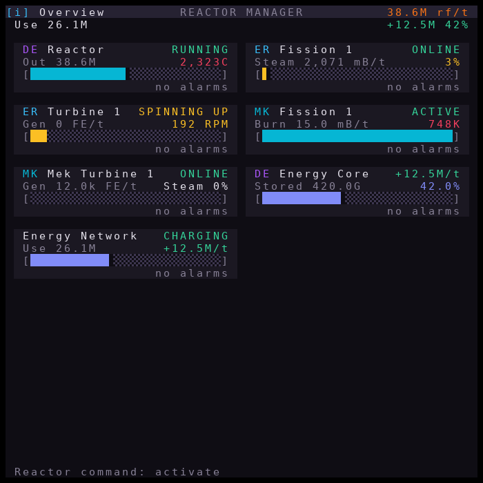

Run `main_control` (or reboot: the installer adds it to `startup.lua`). Every
monitor opens on the **Overview**. The first time, it asks on the computer
which flow gate is the input and which is the output; after that it starts
straight away.

Here, 25 seconds in, the Draconic reactor is heating up (2,323C), the turbine
is **SPINNING UP** with its coils off, and the Bigger Reactors steam tank is
nearly empty. Reactors set to `autoStartOnBoot` start by themselves; the
others wait for you to press **START** on their page.

## 2. The overview


| Part | What it is |
| --- | --- |
| Top bar | `[i] Overview`, then total generation. **Tap it** for the [System page](#9-the-system-page). |
| Second line | Only with energy storage: total use (left), storage flow and charge (right). Tap it for the Energy Network page. |
| Card | Mod tag (`DE` Draconic, `ER` / `BR` Extreme / Bigger Reactors, `MK` Mekanism, `NET` network), name, **status** (right), key reading, a bar, and an alarm line. **Tap a card** to open that unit. |
| Footer | The first active alarm (tap to silence the alarm sound), otherwise the last logged event. With more cards than fit, `<` `1/2` `>` page through them. |

What each card's line and bar mean:

| Unit | Line | Value | Bar |
| --- | --- | --- | --- |
| Draconic reactor | output gate rate | core temperature | containment field |
| Extreme / Bigger reactor | steam made or power | steam tank / battery level | same level |
| Turbine | generation | rotor RPM | RPM (full = cut-off speed) |
| Mekanism fission | burn rate | temperature (K) | coolant level |
| Energy storage | energy stored | charge % | charge |
| Energy Network | total consumption | net storage flow | network charge |

Colours mean the same thing everywhere: green = fine, yellow = attention,
red = danger, grey = off.

## 3. A reactor's page


The top row is the navigation bar:

| Button | Does |
| --- | --- |
| `< Back` | Back to the overview (hidden when the monitor is pinned to this unit) |
| `G` | Graphs |
| `S` | Settings |

Then, for a Draconic reactor:

- **Reactor Status**: RUNNING, WARMING UP, STOPPING, COOLING, COLD, or NO SIGNAL.
- **Generation**, **Temperature** (with a bar towards the trip limit; the
  white `|` marks the target), **Output Gate**, **Input Gate**.
- **Energy Saturation**, **Field Strength** (`T:50` is the target, marked
  `|` on the bar), **Fuel**, and the energy core when one is connected.
- On tall monitors, live **trend charts** fill the free space.
- **START**: charge, then activate; it also clears a latched trip.
  **STOP**: controlled shutdown (the field stays fed until the core is cold).

## 4. Manual output

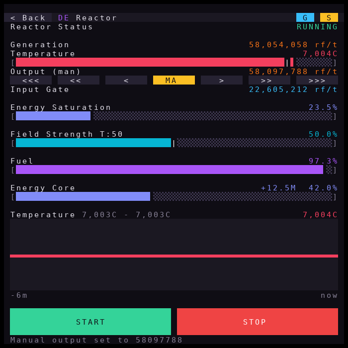

The row under Output Gate sets the output by hand:

| Button | Output change |
| --- | --- |
| `<<<` `<<` `<` | -100k, -10k, -1k RF/t |
| `>` `>>` `>>>` | +1k, +10k, +100k RF/t |
| `AU` / `MA` | Toggle automatic regulation. Green `AU` = automatic, yellow `MA` = manual. |

Pressing any arrow switches to manual (`MA`, and the label becomes
**Output (man)**). Increases ramp in gently, and an interlock switches back
to automatic if the temperature climbs too far or too fast. Tap `MA` to
return to automatic. The mode is remembered across restarts.

## 5. Graphs


`G` opens the history:

- **Energy/h (24h)**: energy per hour over the last day (bars, from zero).
  It fills in as hours pass and survives reboots.
- Line charts of the unit's readings, one sample every `ui.graphInterval`
  seconds. Each **zooms to its own range**, printed after the title
  (`53.9M - 58.0M`), so small changes are visible; the current value is on
  the right. `-6m` / `now` is the time axis.

`X` returns to the unit page.

## 6. Settings

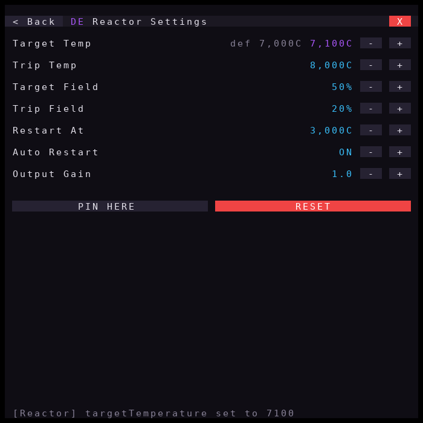

`S` lists the unit's tunable values; `-` / `+` change them by one step.
Changes apply at once and are saved, so they survive reboots. A value that
differs from `config.lua` turns **purple**, with its default beside it (here
Target Temp was raised to 7,100C). Limits are linked: a target can never pass
its trip value.

| Button | Does |
| --- | --- |
| `PIN HERE` / `UNPIN` | Keep this monitor on this unit (remembered across reboots) |
| `RESET` | Put this unit back to its `config.lua` values |
| `X` | Back to the unit page |

## 7. Other units

| Bigger Reactors steam reactor | Turbine |
| --- | --- |
| 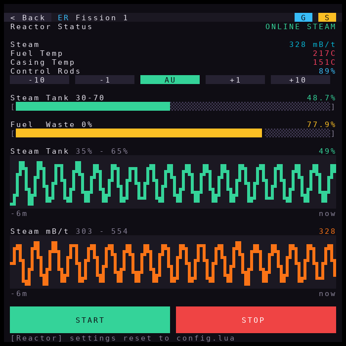 | 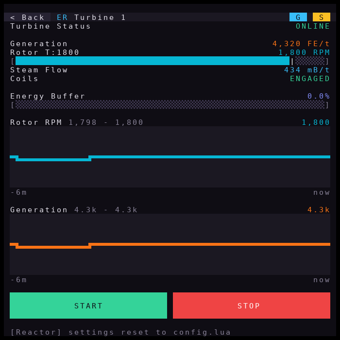 |

- **Extreme / Bigger reactor**: the control rods follow the steam tank (or
  battery) band shown as `Steam Tank 30-70`, so the level swings inside
  that band by design. `-10` `-1` `+1` `+10` move the rods by hand (`MA`);
  `AU` gives control back.
- **Turbine**: held at its target RPM (`T:1800`, marked on the bar). Coils
  disengage while its buffer is full.

| Mekanism fission | Energy storage | Energy Network |
| --- | --- | --- |
| 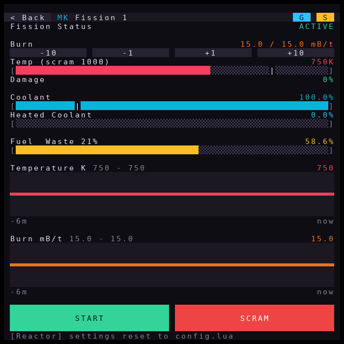 | 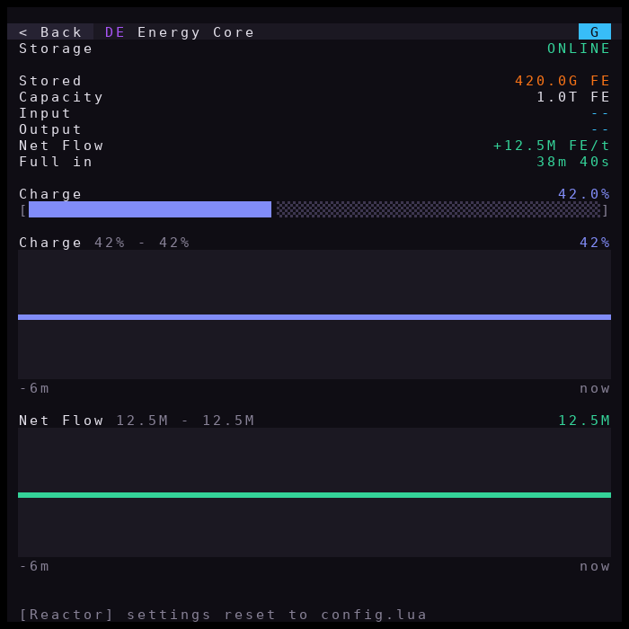 | 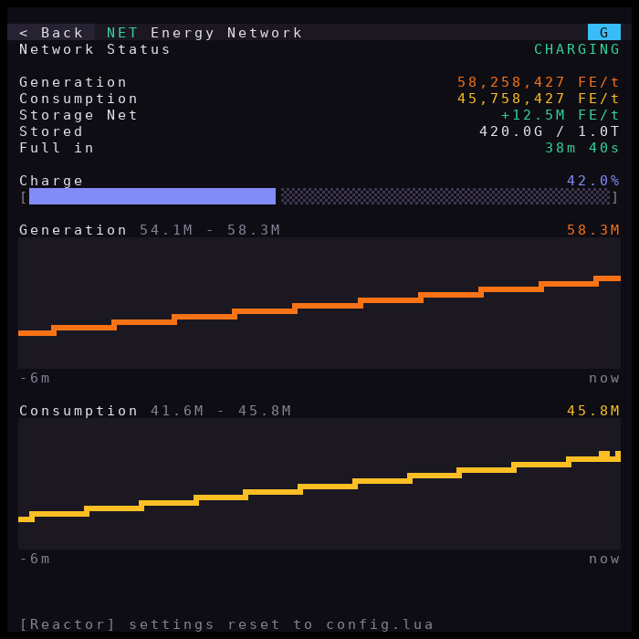 |

- **Mekanism fission**: `-10` `-1` `+1` `+10` set the burn target. The bars
  mark the SCRAM temperature and the minimum coolant. **SCRAM** stops it at
  once.
- **Energy storage** (energy core, induction matrix, EnderIO, ...): stored,
  capacity, flow in and out, net flow, time to full or empty.
- **Energy Network**: every generator and store added together; consumption
  is generation minus what goes into storage.

## 8. Alarms


Here the Mekanism reactor lost its coolant supply and SCRAMmed itself. You
see it in three places:

1. The card's status turns red (**SCRAMMED**) and its alarm line turns into a
   red strip with the reason.
2. The footer shows the first active alarm on every page; `(+2)` means two
   more are active. **Tap the footer** to silence repeating alarm sounds.
3. Speakers, chat boxes and redstone outputs fire if configured
   (`config.alarms`).

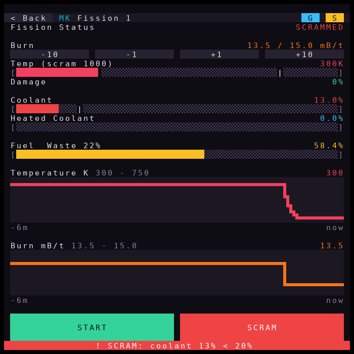

On the unit's page the trend charts show what happened (temperature and
burn rate dropping at the SCRAM). Mekanism trips stay latched: fix the cause,
then press **START**.

## 9. The System page


Tap the top bar of the overview:

- **Version** and **Update**: `CHECK` asks GitHub for a newer version;
  `UPDATE`, then `CONFIRM` within 10 seconds, makes every reactor safe,
  installs the update (keeping your `config.lua`) and reboots.
- **Energy 24h**, **Lifetime** and the network's energy per hour.
- **Alarms**: the count and, when there is room, one row per active alarm.
- **Log shipping**: `OK` / `FAILING` and the queue size when remote logging
  is enabled, otherwise `off`.
- `SILENCE` silences repeating alarm sounds.

## 10. Small monitors

| Overview at 29x19 | With an alarm | Reactor page at 29x19 |
| --- | --- | --- |
|  | 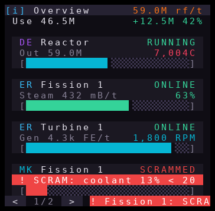 |  |

Everything works the same on a smaller screen:

- Cards shrink to three rows. On a card with an alarm, the alarm replaces
  the reading.
- `<` `1/2` `>` in the footer page through the cards.
- Unit pages drop spacer rows, trend charts and tall buttons first.

The minimum is 29x15 characters.

## 11. When the program stops

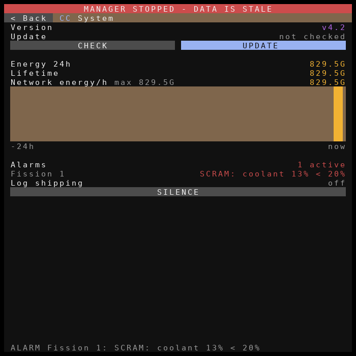

When the program ends (Ctrl+T, a crash or an update), it:

- puts every reactor in its fail-safe state;
- restores the stock ComputerCraft colours;
- stamps **MANAGER STOPPED - DATA IS STALE** across the top of each
  monitor.

The last screen stays visible, but nothing on it is live any more.

## Regenerating the screenshots

From the repository root, with Python 3, Pillow and lupa installed:

```text
python3 tools/screenshots/render.py
```

It reruns the scenario in `tools/screenshots/scenes.lua` and rewrites the
PNGs in `docs/ui/`. Text is drawn with a desktop monospace font rather than
the Minecraft font.
